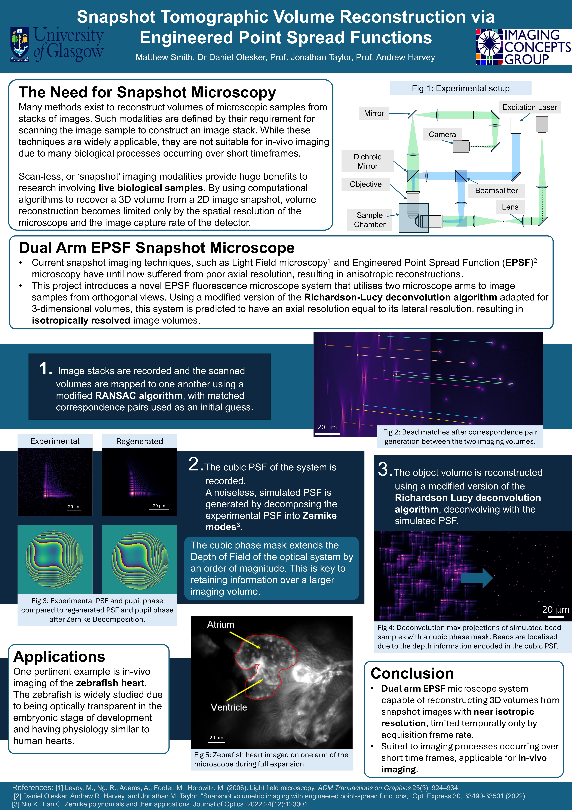

# Bead registration
<table>
<tr>
<td valign="top">

Code that was used to register fluorescence microscope data via fluorescent microbeads during my 2026 EPSRC summer internship with the Imaging Concepts Group at Glasgow University.

This work was interfaced with a larger pipeline for a novel fluorescence snapshot microscope. You can read more about it [here](https://www.linkedin.com/in/matthew-smith-08a22a339/).

</td>
<td width="280" valign="top">

</td>
</tr>
</table>

## Overview of algorithm
I was inspired by a [stack overflow post](https://stackoverflow.com/questions/43126580/match-set-of-x-y-points-to-another-set-that-is-scaled-rotated-translated-and) about astronomy matching algorithms when solving this problem. The registration of pictures of the night sky is a common occurence in astronomy and poses a similar problem - that of matching featureless, point-like sources of light. However, the registration of two orthogonal imaging volumes posed some extra challenges. To overcome this, I extended the trangle based descriptor used in 2D night sky photos to a more robust descriptor.

A four-bead tetrahedral descriptor is created and compared with other possible descriptors in the target volume. The best matching descriptors are determined by mutually having the lowest difference between their combined side lengths. I also imposed an additional hyperparameter which specifies the need for similar descriptors to be near each other in Euclidean space to be marked as matching. This was key to the improvement of the algorithm, and relies on the transformation between volumes being close to a simple 90 degree rotation. Due to the setup being tightly constrained by optical rails, this was a warranted assumption.

After descriptors have been identified and matched, the beads in the descriptor themselves are matched, using a simple check on all $4!$ orderings and choosing the order that gives the lowest error value when compared to the target descriptor coordinates.

After the beads have been matched between volumes, the trasnformation is generated using the RANSAC (RANdom SAmpling Consensus) algorithm. This used a similarity transform as the model during the experimental pipeline. The true transform between the volumes is probably affine, however there were accuracy issues when RANSAC was used with an affine model.

## Results
This successfully registered two volumes seen by orthogonal microscope arms, enabling reconstructed 3D volumes to be mapped together and a volume reproduced from two 2D images. This snapshot microscope is an extension of [previous work](https://opg.optica.org/oe/fulltext.cfm?uri=oe-30-19-33490) by [Dr Daniel Olesker](https://www.gla.ac.uk/schools/physics/research/groups/imagingconcepts/staff-students/dolesker/) [1].

## Areas of improvement
Certain parts of the algorithm naively check all possible combinations of either possible descriptors or points within the descriptors themselves. This could be improved however when hyperparameters are suitably chosen, the algorithm runs in under 5 seconds. Bead sets have to be relatively sparse ($\approx$ 20-50 beads), with experimental data containing around 20 beads.

## Use
Work on the microscope setup is still ongoing and so the rest of the code cannot be released. As such, this registration code cannot be run on its own as there is no implementation included for registering bead locations. This could be implemented by the user however.

The jupyter notebook registration_demo.ipynb demonstrates the registration process, but cannot be run without volume localisation. 

Updates to come.

[1] Daniel Olesker, Andrew R. Harvey, and Jonathan M. Taylor, "Snapshot volumetric imaging with engineered point-spread functions," Opt. Express 30, 33490-33501 (2022)